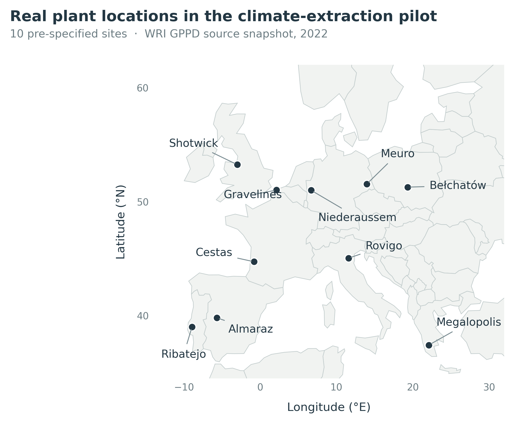
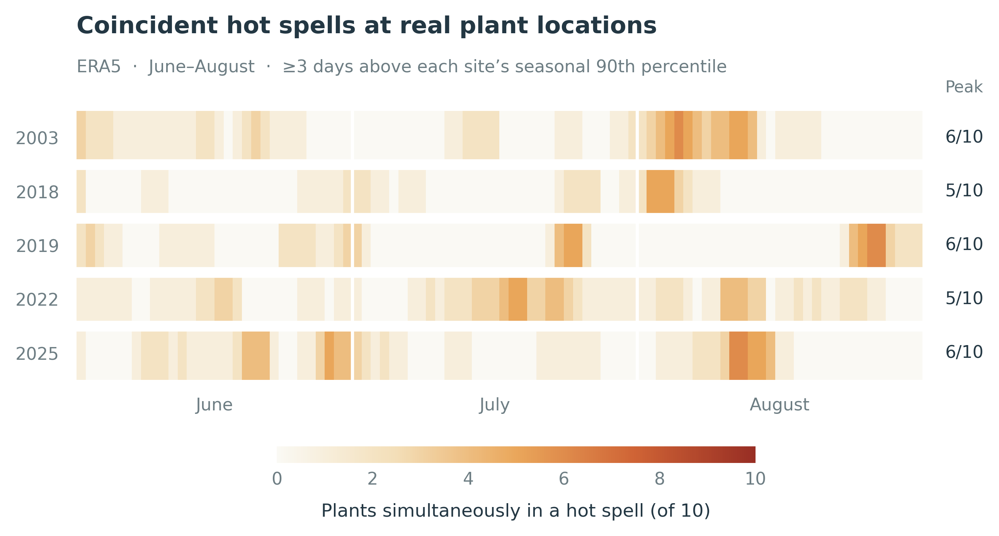

# Heatwave: condition information, adaptation and insurance

Real climate-input pilot and methods audit for an actuarial digital twin study.

**Current status:** genuine plant locations and historical/projection temperature data are available. The imported insurance model and its saved benefits remain synthetic and uncalibrated. This repository does not yet establish European insured heat losses, earned insurance credibility, regulatory capital relief or readiness for Nature Climate Change.

## Start here

- [Methods, journal fit and figure review](docs/methods_and_journal_review.md)
- [Data sources, licences and limitations](DATA_SOURCES.md)
- [Figure captions](docs/figure_captions.md)
- [Historical-data checks](data/provenance/era5_summary.json)
- [CMIP6 extraction completion](data/provenance/cmip6_status.json)
- [Source requests and SHA-256 hashes](data/provenance/download_manifest.json)

## Retrieved data

| Dataset | Scope | Versioned snapshot |
|---|---|---|
| WRI plant inventory | 10,050 records; EU27 + UK, Norway and Switzerland; 2022 source snapshot | `data/processed/europe_plant_inventory.csv.gz` |
| ERA5 daily temperature | 10 real sites, 1991-2025, Tmax and Tmin; 127,840 complete site-days | `data/processed/era5_daily_pilot.csv.gz` |
| NEX-GDDP-CMIP6 | Two models, SSP1-2.6/SSP5-8.5, 2041-2060, two pilot sites; see completion manifest | `data/processed/cmip6_daily_pilot.csv.gz` |
| Derived historical diagnostics | Seasonal thresholds, three-day hot spells, summer indicators and common-date co-occurrence | Small CSVs in `data/processed/` |

Pilot locations are chosen by pre-specified country/fuel strata and recorded capacity. They are not an actual insurance book or a representative sample. No missing observations are replaced with synthetic values.

## Reproduce without downloading

Python 3.10+:

```bash
python -m pip install -r requirements.txt
python scripts/unpack_data.py
python scripts/detect_heatwaves.py
python scripts/make_figures.py
python scripts/audit_prototype.py
python -m unittest discover -s tests -v
```

`make_figures.py` obtains a small public-domain Natural Earth basemap only if it is absent. The included basemap makes the full default figure workflow available offline.

## Refresh or expand the real inputs

```bash
python scripts/fetch_inputs.py
python scripts/fetch_cmip6.py
python scripts/validate_data.py
python scripts/package_data.py
```

The historical downloader explicitly requests the ERA5 model, UTC days, nearest cell and disabled elevation downscaling. It retains returned grid coordinates and rejects missing temperatures. Requests are cached with source metadata; a rate-limit response requires resuming later. The future downloader discovers available NASA filenames from their catalogs and records every model, ensemble member, scenario and file version. Default extraction uses three concurrent read requests, with an upper limit of four. Use `--help` for scope options. Expansion requires respecting the providers' access policies.

Raw global/climate downloads and their caches are excluded from git to keep the repository small. Compressed public snapshots and the acquisition manifest retain the study inputs and lineage. `validate_data.py` checks cached raw hashes when caches are present; it checks dataset identities and date coverage independently of their source URLs.

## Original model and new methods utilities

`prototype/` preserves the seven original scripts and supplied JSON summaries unchanged. Original script entry points should be run from that directory. The map builder references a missing external file, and the original plotting/manuscript files were not supplied.

`heatwave/credibility.py` supplies tested joint Gaussian conditioning that retains residual spatial dependence. `heatwave/risk.py` supplies empirical expected shortfall with exact tail-mass handling and held-out funding-shortfall metrics. These isolated building blocks do not imply that the original simulator's methods issues have been fully repaired or that its vulnerability assumptions have been calibrated.

## Data figures





SVG, PDF and 350-dpi PNG versions are in `figures/`. The figures show real exposure diagnostics; they do not portray observed failures or avoided claims.
